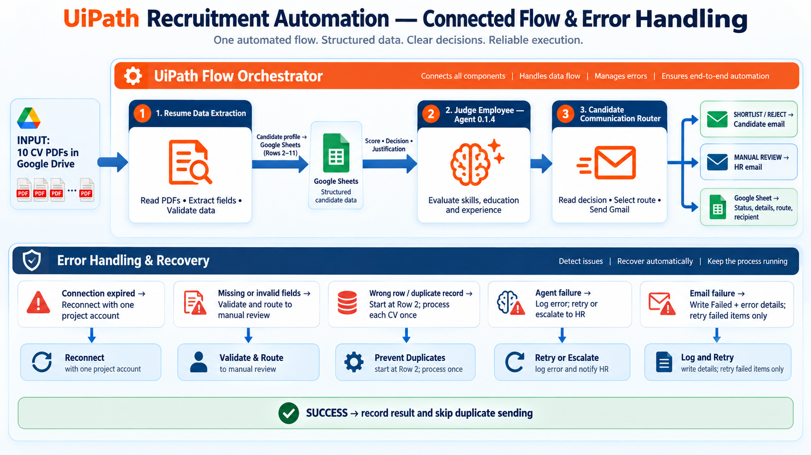

# UiPath AI Recruitment Pipeline

An end-to-end university automation project that processes CVs, extracts structured data, evaluates job fit with an AI agent, and routes candidate communications through Gmail.

> Portfolio-safe edition: account names, candidate data, Google resource IDs, and UiPath connection IDs have been replaced with examples. Importing the source requires creating your own resources and rebinding the activities in Studio Web.



## What the automation demonstrates

The solution connects five UiPath capabilities in one data pipeline:

1. **Cloud and UI automation** — Studio Web coordinates the projects and exposes the full run for debugging.
2. **Structured-data automation** — Google Sheets is the shared state store for extracted fields, scores, decisions, and delivery status.
3. **PDF data extraction** — Document Understanding converts CV documents into structured candidate fields.
4. **Agentic automation** — a LangGraph-based UiPath coded agent evaluates only job-relevant evidence and returns a structured score and recommendation.
5. **Email automation** — Gmail sends candidate or HR messages according to the screening outcome.

## End-to-end design

```text
Google Drive CV folder
        |
        v
RPA Workflow: extract CV fields -> Google Sheet rows
        |
        v
RPA Workflow 1: evaluate pending rows with the coded agent
        |
        v
CandidateCommunicationRouter: route outcome and send email
        |
        v
Google Sheet: persist score, decision, email status, and audit details
```

`RecruitmentOrchestrator.flow` connects the three RPA processes and the agent as one Studio Web solution.

## Reliability work included

- **Correct row alignment:** candidate data starts at row 2 and downstream writes use the same row index.
- **Duplicate prevention:** one CV produces one candidate record; reruns use status fields instead of appending duplicate rows.
- **Idempotent email handling:** rows already marked as successfully sent are skipped, while failed sends can be retried.
- **Observable outcomes:** the sheet records screening, communication route, recipient, send status, and error detail.
- **Human fallback:** uncertain cases are routed to HR review rather than being silently accepted or rejected.
- **Connection isolation:** public source contains neutral placeholder IDs and must be rebound to the deployer's own Google and UiPath resources.

## Repository layout

```text
docs/                              Architecture and setup notes
samples/                           Synthetic demonstration data
solution/
  RPA Workflow/                    CV extraction and sheet writeback
  RPA Workflow 1/                  Agent evaluation and result writeback
  Agent/                           LangGraph coded agent and evaluation assets
  CandidateCommunicationRouter/    Email routing and delivery status
  RecruitmentOrchestrator/         Maestro Flow orchestration
```

The tenant-specific `.uipx`, generated solution resources, deployment archives, debug profiles, and Integration Service bindings are intentionally excluded. The small allowlisted `.entities`, `.project`, and JIT DLL artifacts are retained because Studio needs those generated types to compile the Document Understanding, JSON, and typed-row activities. Create a new UiPath Solution and import the five projects as described in [Setup](docs/SETUP.md).

Repository-level checks and the remaining Studio Web verification step are recorded in [Validation notes](docs/VALIDATION.md).

## Responsible-use boundary

This is an educational prototype, not a production applicant-tracking system. It should use synthetic or consented data only. Automated output is an initial screening aid; a qualified human must make the final employment decision. Protected characteristics must never be inferred or used.

## Portfolio context

This repository is presented as an individual portfolio project. It documents the design, implementation, debugging, and responsible-use decisions behind the automation.

## License

Shared for educational and portfolio review under the terms in [LICENSE](LICENSE). No permission is granted to deploy it for real hiring decisions.
